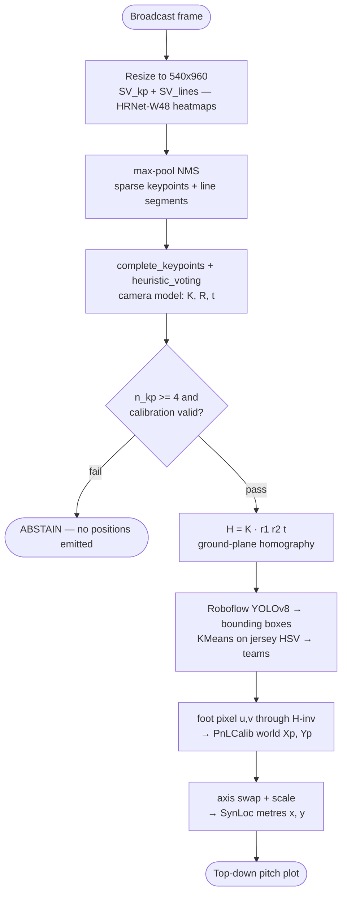

# M1 Pipeline Flowchart

PnLCalib recovers the full camera model from pitch-marking appearance; frames with fewer than 4 confident keypoints abstain rather than emit a degenerate homography; valid calibrations project each player's foot contact point through H-inv and a fixed coordinate conversion into metric pitch coordinates.
