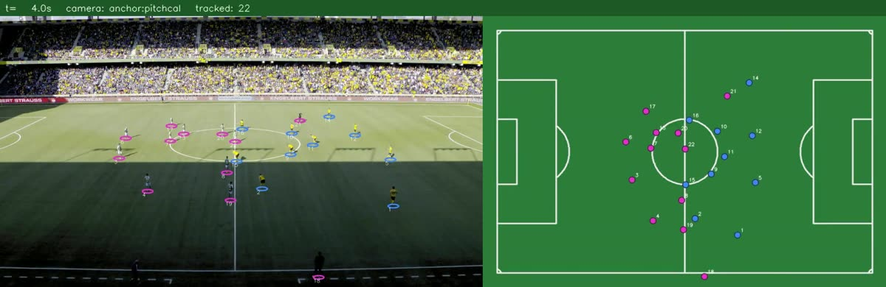
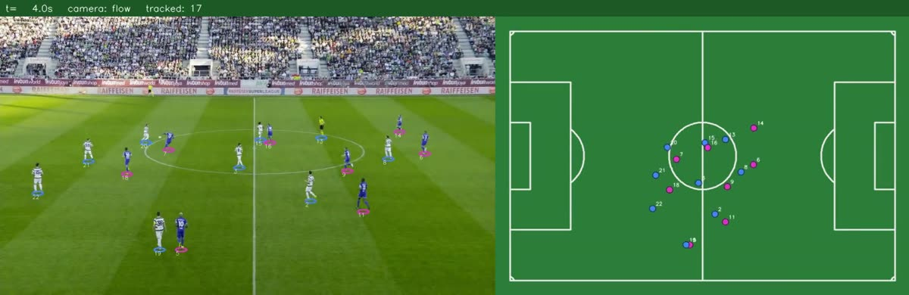
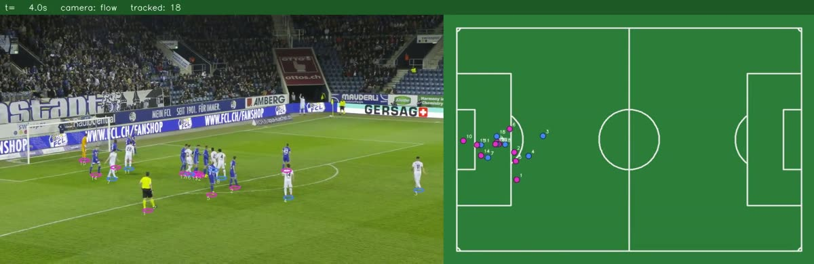
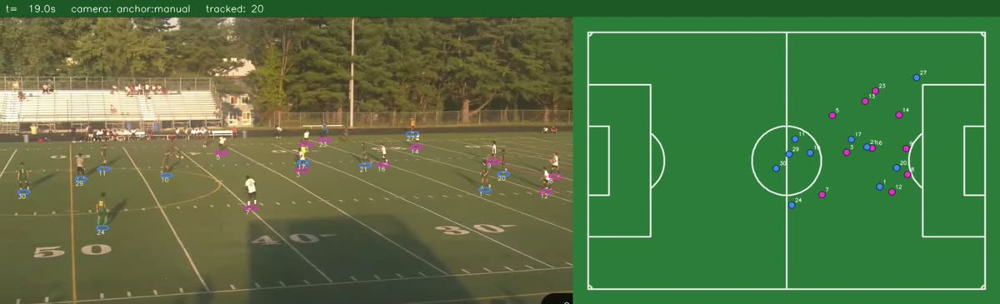

# Video pipeline results

## SoccerNet GSR clips

Three clips from the SoccerNet Game State Reconstruction set, scored against ground truth with `eval/gsr/evaluate.py`. SNGS-025 was drawn at random only after tuning, so it is the held-out clip. Detection is RF-DETR (COCO, local, CPU). Every frame of all three clips calibrated.

| Clip | Position error, median / p90 | Recall | Precision | IDF1 | Team accuracy |
|---|---|---|---|---|---|
| SNGS-048: kick-off, hard shadow | 0.51 / 1.32 m | 94% | 95% | 0.857 | 98.5% |
| SNGS-082: shot, fast pan | 0.53 / 1.34 m | 94% | 99% | 0.773 | 96.2% |
| SNGS-025: corner (held out) | 0.65 / 1.59 m | 88% | 98% | 0.652 | 97.7% |

With the ground-truth boxes as detections ("oracle"), IDF1 is 0.939, 0.871 and 0.731. The difference shows how much of the remaining tracking error comes from detection.

Still open:
- ID switches in crowded scenes (corners);
- a single-frame anchor can be about 1 m off, and the tracker inherits that error.





## Multi-sport turf (phone screen recording, 21 s)

This is a high-school game on a field with American-football yard lines painted over yellow and orange soccer lines. The team in green plays a team in white, on green turf, in low sun.

**Calibration.** pitchcal refused every frame: the white football lines match no soccer template, and in low sun the soccer lines can't be told apart from them by colour. The camera was anchored with `--anchor-file` instead.
- The anchor is [`examples/anchor_multisport_turf.json`](../../examples/anchor_multisport_turf.json).
- It uses the 50/45/40/35/30 yard lines crossed with the near sideline and the near hash row. The soccer halfway line is assumed to be the 50, on a 105 × 68 m pitch centred on the football field.
- The anchor's prediction of the centre circle lands on the painted one.

**Command:**

```bash
.venv/bin/python pipeline/video/run_video.py match.mp4 --out out/turf \
    --detector rfdetr --detect-stride 3 --anchor-file examples/anchor_multisport_turf.json
```

**Result with RF-DETR:**
- 90% of frames are calibrated. The first 2.1 s are lost because backward flow broke there.
- 30 stitched tracks, with 16–20 people tracked at a time.
- Team separation score is 0.35. Green on green turf in low sun is hard for colour signatures, and RF-DETR has no referee class, so the referee is counted as a player.


