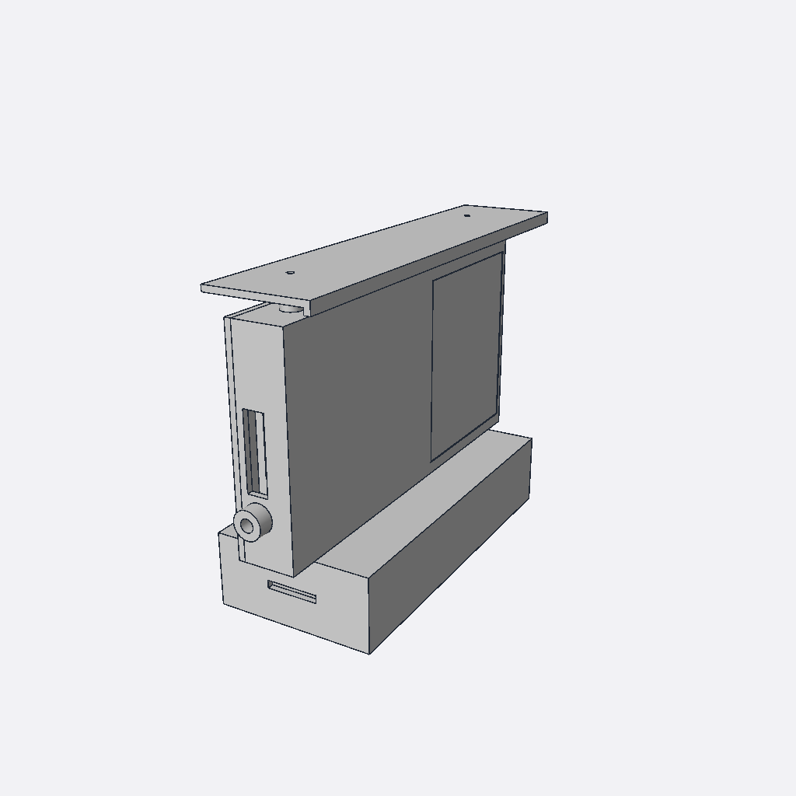
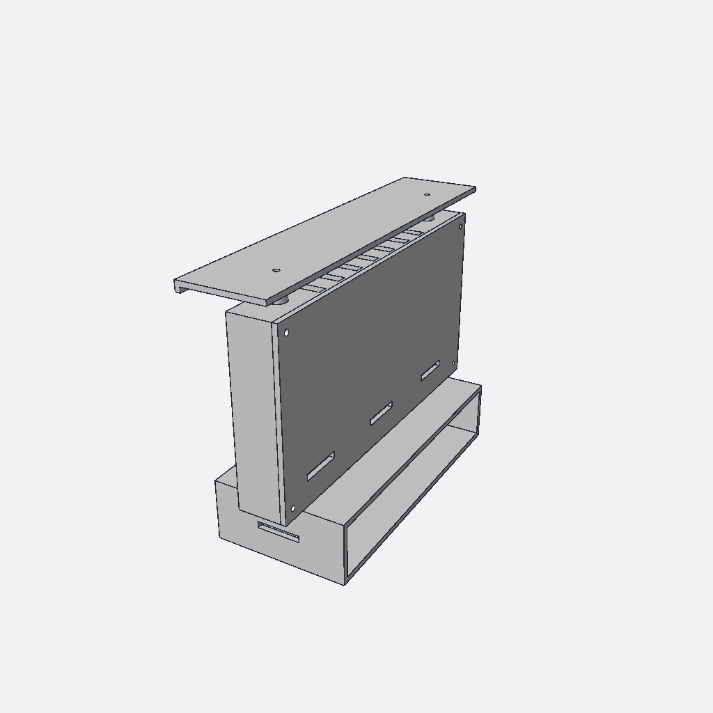

# Phone camera enclosure, v1 (test rig)

> Superseded by the open cradle in [`../open_rig`](../open_rig). The window pane was removed at your request, so the front window is open. All printed parts are now set to PLA.

The phone housing described in [`docs/phone_enclosure_brief.md`](../../docs/phone_enclosure_brief.md).
It was modelled in Manti, in the project **Camera Enclosure**:
https://app.mantiai.com/projects/p_9bac9c667006b013

All parts share one coordinate frame, so every STEP file opens already in its assembled position:

- X runs along the phone;
- +Y is the direction the camera looks, through the window;
- Z points up;
- the housing floor is at Z = 0.

 

## Parts

| File | Part | Make | Mass (ABS) | Print orientation |
|---|---|---|---|---|
| `housing.*` | Phone box. The back is open; the front has the open window aperture (pane removed). Inside are rails and ledges. Also has the end stop, the clamp screw boss, the cable slot and the top outlet vents. | FDM | 136 g | Front face down (the window rabbet sits on the bed). Needs a bed of at least 210 × 112 mm. |
| `lid.*` | Back cover. Three low inlet vents and two foam-pad bosses. | FDM | 76 g | Outer face down |
| `roof.*` | Sun roof on two posts with a 12 mm air gap. It overhangs 20 mm at the front and has a 3 mm drip lip. | FDM | 39 g | Upside down (plate on the bed) |
| `jaw.*` | Clamp jaw, pushed by the thumbscrew, with a notch for the charging plug. | FDM | 5 g | On its large face |
| `base.*` | Bay for the power bank. It has an Arca-style dovetail and inserts for 1/4"-20 and 3/8"-16 tripod screws. | FDM | 158 g | On its open back face, so the 45° dovetail bevels need no supports |

`src/*.manti` holds the MantiCAD programs. Every dimension is a named variable with a description. The ones you will change most often:

- `jaw.manti` → `phone_len`. Set it to your phone's length and re-export. The jaw thickens to fill the gap, covering phones 130–166 mm long.
- `base.manti` → `bank_l`, `bank_w`, `bank_t`. Set these to your power bank's dimensions.
- `housing.manti` → `phone_w_max`, `phone_t_max`, `rail_h` (bump clearance), and the window `win_*`.

## Hardware

| Qty | Item | Where |
|---|---|---|
| 4 | M3 heat-set insert + M3×8 screw | Lid to housing corner bosses |
| 2 | M3 heat-set insert + M3×20 screw | Roof posts to housing top |
| 2 | M4 heat-set insert + M4×10 screw | Housing floor to bay top |
| 1 | M5 heat-set insert + M5×25 thumbscrew | Clamp jaw, +X end |
| 1 | 1/4"-20 UNC heat-set insert | Bay rail, centre |
| 1 | 3/8"-16 UNC heat-set insert | Bay rail, X = +30 |
| 2 | EVA foam pad, 3 mm, 20 × 50 mm | Lid pad bosses; holds the phone against the rails |
| — | Foam gasket tape, 3 × 6 mm | Lid perimeter |
| 1 | Hook-and-loop strap, 25 mm | Through the bay's end slots, around the power bank |
| 1 | USB-C cable with right-angle plugs | Bank → floor hole → phone |

## Print settings

- Material: PLA, as requested. It softens at about 55–60 °C, so use PETG or ASA for long sessions in hot sun.
- Nozzle 0.4 mm, layers 0.2 mm, 8 perimeters (3.2 mm walls are solid), infill 30 % gyroid.
- Supports: none for the lid, roof, jaw and bay. On the housing, printed front-down:
  - the top vents bridge 6 mm;
  - the ceiling of the end-wall cable slot is a 38 mm bridge. Support that one slot only, or tune bridging and accept a little sag; it is not a sealing face.
- Colour: white or light grey, to reflect sunlight.

## Checks done in Manti

- Every sketch is fully defined.
- Every part is one valid, watertight solid with no self-intersections. Manti checked this exactly before each export.
- The assembly has no overlap between any pair of parts. The interference check found only zero-volume contacts: housing↔lid, housing↔roof, housing↔bay and lid↔bay.
- STL files are within 0.025 mm of the exact model.
- Section views confirmed that:
  - each M4 insert lines up with its housing clearance hole;
  - the cable holes line up;
  - the tripod inserts sit in the rail.
- Lens view under the hood, checked by hand:
  - The worst case is the lens top at Z ≈ 82 mm with a 42.5° vertical half-angle.
  - At the hood edge (Y = 32.75) that ray is at Z ≈ 82 + 25 × tan 42.5° ≈ 105 mm.
  - The drip lip's underside is at Z = 117.4 mm, so there is about 12 mm to spare.

## Assumptions and open items (not yet verified)

- **Insert hole sizes are assumed.** M3 is Ø4.0, M4 Ø5.6, M5 Ø6.4, 1/4"-20 Ø8.0 and 3/8"-16 Ø12.0. Check them against the insert maker's table before printing; each is one variable.
- **The Arca dovetail dimensions are from memory and unconfirmed.** The model uses 38 mm wide at the clamp face with 5 mm 45° bevels. Test-fit the clamp before relying on it, or mount through the 1/4"-20 insert.
- **ABS stands in for ASA in Manti**, which has no ASA entry. This only affects the listed masses.
- **No tilt adjustment is built in.** Use a ball head or a tilt head on the Arca rail or the 1/4"-20 insert. Pole and railing clamps are also off-the-shelf.
- **Starting a recording means removing the lid** (4 screws). Alternatives are a Bluetooth shutter remote or a scheduled-recording app.
- **The jaw is not guided.** The lid's foam pads and the thumbscrew hold it in place.
- **Nothing has been printed yet.** Run the acceptance tests in the brief: fit with the smallest and largest phone, a vignetting check, a 2 h heat run, a shake test and a rain test.
