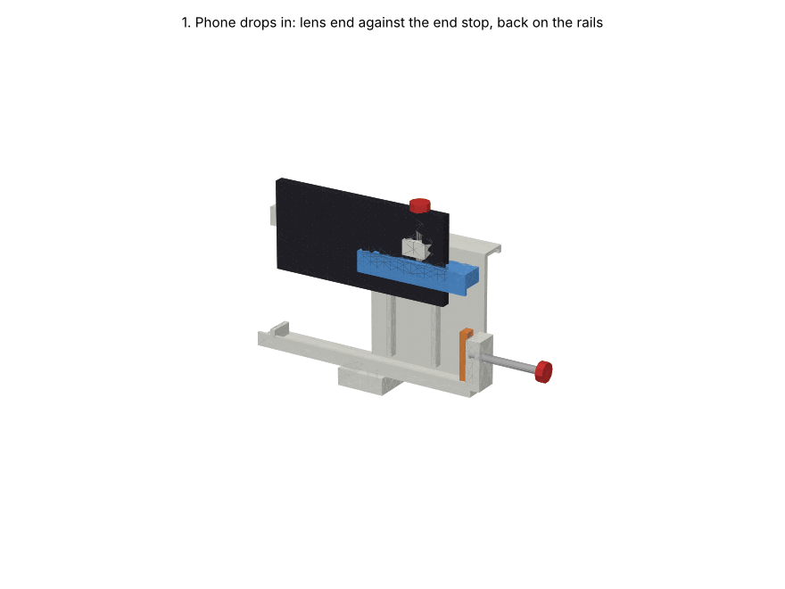

# Open phone cradle with screw grippers, v2, on a mock tripod

An open replacement for the v1 box. It is modelled in the Manti project **Camera Enclosure**
(https://app.mantiai.com/projects/p_9bac9c667006b013), in the assembly `cad/open_rig.manti-assembly`.

All parts share one coordinate frame:

- X runs along the phone, with the camera end at −X;
- +Y is the direction the camera looks;
- Z points up;
- the phone's bottom edge sits at Z = 0.

## How it holds the phone

1. **Camera end.** The phone's lens end butts against a low end stop (X = −82). From there to the left end of the cradle, the camera side is fully open, from the bottom lip up to 88 mm. Every lens position on 130–166 mm phones looks straight out with nothing in front of it.
2. **Back.** The phone's back rests on two 7 mm rails, which clear a 5 mm camera bump.
3. **Screen side.** The screen side is open, so you can tap Record. Two thin lips, at the bottom and on the top clamp, stop the phone falling forward. Stick 3 mm foam on them for thinner phones.
4. **End gripper.** An M6 thumbscrew in the end block (X 91–103) pushes the orange end jaw along X. It pins the phone against the end stop.
5. **Top gripper.** An M6 thumbscrew in the nut block above (Z 97–109) drives the blue top clamp down onto the phone's top edge. The two M5 bolts in the vertical slots are only guides; leave them finger-loose, or use shoulder bolts.
6. **Sun visor.** A 20 mm visor with a drip lip runs along the top, outside the lens's view.
7. **Mount.** A 1/4"-20 insert under the cradle screws onto any tripod.

## Screw travel check

`animate_grippers.py` computes this and asserts it before it renders.

| Phone (L × W, mm) | End screw past its head (M6×60) | Top screw past its head (M6×40) | Guide bolt height (slot 70–92 mm) |
|---|---|---|---|
| 130 × 64 | 49 mm | 33 mm | 70 mm |
| 150 × 72 | 29 mm | 25 mm | 78 mm |
| 166 × 80 | 13 mm | 17 mm | 86 mm |

Every combination of 130/150/166 mm length and 64/72/80 mm width passes. The longest phone leaves 1 mm between the jaw and the end block. The widest phone leaves 5 mm between the clamp and the nut block.

## Parts

All printed parts are **PLA**, as requested. PLA softens at about 55–60 °C, so don't leave the rig in a hot car or in full summer sun for hours. For long exposure in sun, reprint in PETG or ASA.

| File | Part | Notes |
|---|---|---|
| `cradle.*` | Cradle (PLA) | Print on its back face, with the camera side down |
| `top_clamp.*` | Top clamp (PLA) | Has a screw seat on top and M5 inserts for the guide bolts |
| `end_jaw.*` | End jaw (PLA) | Has a screw seat on its back |
| `tripod_mast.*`, `tripod_leg.*` | **Mock** tripod (aluminium) | For visualising only: a 1/4"-20 stud, a 300 mm column, and three 900 mm legs at 25° |

## Hardware

| Qty | Item |
|---|---|
| 2 | M6 heat-set insert, plus M6 thumbscrews: one ×60 (end), one ×40 (top) |
| 2 | M5 heat-set insert + M5×12 bolt and washer (clamp guides) |
| 1 | 1/4"-20 UNC heat-set insert (tripod) |
| — | 3 mm EVA foam strip for the lips, jaws and rails |

## Assumptions (unverified)

- Insert hole sizes are assumed: M5 Ø6.4, M6 Ø8.0, 1/4"-20 Ø8.0. Check them against the insert maker's table.
- The end jaw floats until its screw touches it. A captive screw tip, or a TPU pad glued to the jaw, would stop it dropping out when you take the phone out.
- The tripod is a mock. Its legs overlap the hub slightly where they join.
- Nothing has been printed yet.
