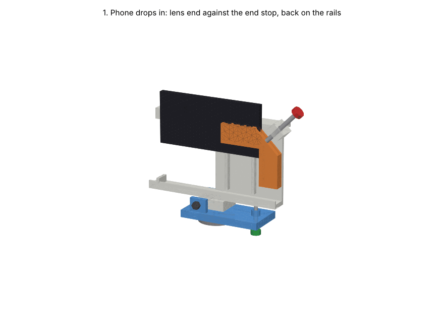

# Open phone cradle, v3: one-screw corner lock and roll adjustment, on a mock tripod

An open replacement for the v1 box. It is modelled in the Manti project **Camera Enclosure**
(https://app.mantiai.com/projects/p_9bac9c667006b013), in the assembly `cad/open_rig.manti-assembly`.

All parts share one coordinate frame:

- X runs along the phone, with the camera end at −X;
- +Y is the direction the camera looks;
- Z points up;
- the phone's bottom edge sits at Z = 0.

## How it holds the phone

1. **Camera end.** The phone's lens end butts against a low end stop (X = −82). From there to the left end of the cradle, the camera side is fully open, from the bottom lip up to 88 mm. Every lens position on 130–166 mm phones looks straight out with nothing in front of it.
2. **Back.** The phone's back rests on two 7 mm rails, which clear a 5 mm camera bump.
3. **Screen side.** The screen side is open, so you can tap Record. The bottom lip and the corner jaw's lip stop the phone falling forward. Stick 3 mm foam on them for thinner phones.
4. **One-screw corner lock (X and Z).** One M6×60 thumbscrew sits in a block on the cradle's top-right corner and points down and in at 45°. It pushes the orange L-shaped corner jaw onto the phone's top-right corner. That one push presses the phone toward the end stop (X) and down onto the bottom lip (Z) with equal force.
   - The screw tip rides in a 6.5 mm groove across the jaw's 45° back face. The jaw can slide along the groove to seat squarely on both edges, but cannot slip out sideways.
   - The jaw's 3 mm screen-side lip also holds the top corner in Y.
5. **Roll adjustment.** The cradle no longer screws straight onto the tripod. It sits on a blue roll base and pivots on an M6 bolt along Y (X = −15, Z = −13), so turning it rolls the camera about its viewing direction.
   - An M5 adjust screw comes up through the base at X = +60. Its tip sits in a seat under the bottom lip.
   - The phone's weight is on the +X side of the pivot, so the cradle always rests on the adjust screw.
   - One turn of an M5 (0.8 mm) rolls about 0.6°. The range is about −6.5° (mount block reaches the base) to +7.6° (screw length).
   - Level the horizon, then tighten the pivot bolt's nut to hold it.
6. **Sun visor.** A 20 mm visor with a drip lip runs along the top, outside the lens's view.
7. **Mount.** A 1/4"-20 insert under the roll base screws onto any tripod.

## Screw travel check

`animate_rig.py` computes this and asserts it before it renders.

| Phone (L × W, mm) | Corner screw shank past the block (M6×60) | Tip offset along the groove (max 19) | Jaw to screw block gap |
|---|---|---|---|
| 130 × 64 | 56.4 mm | 7.1 mm | 40.4 mm |
| 130 × 80 | 45.1 mm | 18.4 mm | 29.1 mm |
| 150 × 72 | 36.6 mm | 1.4 mm | 20.6 mm |
| 166 × 64 | 30.9 mm | 18.4 mm | 14.9 mm |
| 166 × 80 | 19.6 mm | 7.1 mm | 3.6 mm |

Every combination of 130/150/166 mm length and 64/72/80 mm width passes.

Roll adjust screw (M5×40), measured from the base underside to the seat: 21.0 mm at −6.5°, 29.5 mm level, 39.3 mm at +7.6°.

## Parts

All printed parts are **PLA**, as requested. PLA softens at about 55–60 °C, so don't leave the rig in a hot car or in full summer sun for hours. For long exposure in sun, reprint in PETG or ASA.

| File | Part | Notes |
|---|---|---|
| `cradle.*` | Cradle (PLA) | Has the corner screw block, the roll pivot bore through the mount block, and the adjust screw seat. Print on its back face |
| `corner_jaw.*` | Corner jaw (PLA) | L-shaped, with the screw groove on its 45° back face. Print with the screen-side lip up |
| `roll_base.*` | Roll base (PLA) | Pivot ears, the adjust screw boss and the 1/4"-20 insert. Print flat, with the plate down |
| `tripod_mast.*`, `tripod_leg.*` | **Mock** tripod (aluminium) | For visualising only: a 1/4"-20 stud, a 300 mm column, and three 900 mm legs at 25° |

## Hardware

| Qty | Item |
|---|---|
| 1 | M6 heat-set insert + M6×60 thumbscrew (corner lock) |
| 1 | M6×60 bolt, washers and a nyloc or wing nut (roll pivot) |
| 1 | M5 heat-set insert + M5×40 thumbscrew (roll adjust) |
| 1 | 1/4"-20 UNC heat-set insert (tripod, in the roll base) |
| — | 3 mm EVA foam strip for the lips, jaw and rails |

## Getting STL files

- They are already here: `cradle.stl`, `corner_jaw.stl`, `roll_base.stl` (print these), plus the mock tripod's `tripod_*.stl`. Each matches the exact model to 0.05 mm.
- On the web: the Manti project page, under `cad/exports/`.
- From the STEP files: open the `.step` in any CAD tool (Fusion, FreeCAD, Onshape, Prusa/Bambu slicers also import STEP) and export or slice it directly.

## Assumptions (unverified)

- Insert hole sizes are assumed: M5 Ø6.4, M6 Ø8.0, 1/4"-20 Ø8.0. Check them against the insert maker's table.
- The corner jaw is loose until its screw touches it. Back the screw off only a few turns to swap phones, or glue a TPU pad in the groove to keep the jaw from falling out.
- The roll pivot relies on friction once the nut is tightened. A wing nut makes it tool-free.
- The tripod is a mock. Its legs overlap the hub slightly where they join.
- Nothing has been printed yet.
